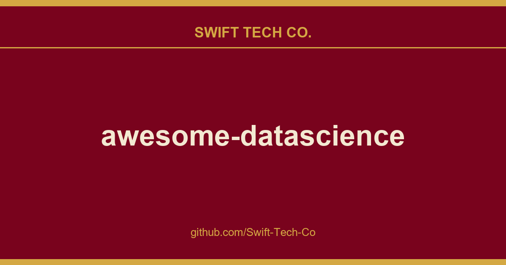

# awesome-datascience

## What This Is

We keep a working index for product and engineering, and awesome-datascience is the entry that collects our notes, examples and fixes. It reflects how Swift Tech Co. actually uses this in builds and client work.

## Images

[](https://github.com/Swift-Tech-Co)

## $ academic

```
$ brew tap academic/tap
$ brew install academic
```

## Table of Contents

- [What is Data Science?](#what-is-data-science)
- [Where do I Start?](#where-do-i-start)
- [Agents](#agents)
- [Projects](#projects)
- [Training Resources](#training-resources)
  - [Tutorials](#tutorials)
  - [Free Courses](#free-courses)
  - [Massively Open Online Courses](#moocs)
  - [Intensive Programs](#intensive-programs)
  - [Colleges](#colleges)
- [The Data Science Toolbox](#the-data-science-toolbox)

  - [Algorithms](#algorithms)
    - [Supervised Learning](#supervised-learning)
    - [Unsupervised Learning](#unsupervised-learning)
    - [Semi-Supervised Learning](#semi-supervised-learning)
    - [Reinforcement Learning](#reinforcement-learning)
    - [Data Mining Algorithms](#data-mining-algorithms)
    - [Deep Learning Architectures](#deep-learning-architectures)
  - [General Machine Learning Packages](#general-machine-learning-packages)
  - [Deep Learning Packages](#deep-learning-packages)
    - [PyTorch Ecosystem](#pytorch-ecosystem)
    - [TensorFlow Ecosystem](#tensorflow-ecosystem)
    - [Keras Ecosystem](#keras-ecosystem)
  - [Visualization Tools](#visualization-tools)
  - [Miscellaneous Tools](#miscellaneous-tools)
- [Literature and Media](#literature-and-media)
  - [Books](#books)
    - [Book Deals (Affiliated)](#book-deals-affiliated)
  - [Journals, Publications, and Magazines](#journals-publications-and-magazines)
  - [Newsletters](#newsletters)
  - [Bloggers](#bloggers)
  - [Presentations](#presentations)
  - [Podcasts](#podcasts)
  - [YouTube Videos & Channels](#youtube-videos--channels)
- [Socialize](#socialize)
  - [Facebook Accounts](#facebook-accounts)
  - [Telegram Channels](#telegram-channels)
  - [Slack Communities](#slack-communities)
  - [GitHub Groups](#github-groups)
  - [Data Science Competitions](#data-science-competitions)
- [Fun](#fun)
  - [Infographics](#infographics)
  - [Datasets](#datasets)
  - [Comics](#comics)
- [Other Awesome Lists](#other-awesome-lists)
  - [Hobby](#hobby)

## What is Data Science?
**[`^        back to top        ^`](#awesome-data-science)**

Data Science is one of the hottest topics on the Computer and Internet farmland nowadays. People have gathered data from applications and systems until today and now is the time to analyze them. The next steps are producing suggestions from the data and creating predictions about the future. Here you can find the biggest question for **Data Science** and hundreds of answers from experts.


| Link | Preview |
| --- | --- |
| Data Science For Beginners | Microsoft are pleased to offer a 10-week, 20-lesson curriculum all about Data Science. |
| What is Data Science @ O'reilly | _Data scientists combine entrepreneurship with patience, the willingness to build data products incrementally, the ability to explore, and the ability to iterate over a solution. They are inherently interdisciplinary. They can tackle all aspects of a problem, from initial data collection and data conditioning to drawing conclusions. They can think outside the box to come up with new ways to view the problem, or to work with very broadly defined problems: “here’s a lot of data, what can you make from it?”_ |
| What is Data Science @ Quora | Data Science is a combination of a number of aspects of Data such as Technology, Algorithm development, and data interference to study the data, analyse it, and find innovative solutions to difficult problems. Basically Data Science is all about Analysing data and driving for business growth by finding creative ways. |
| The sexiest job of 21st century | _Data scientists today are akin to Wall Street “quants” of the 1980s and 1990s. In those days people with backgrounds in physics and math streamed to investment banks and hedge funds, where they could devise entirely new algorithms and data strategies. Then a variety of universities developed master’s programs in financial engineering, which churned out a second generation of talent that was more accessible to mainstream firms. The pattern was repeated later in the 1990s with search engineers, whose rarefied skills soon came to be taught in computer science programs._ |
| Wikipedia | _Data science is an interdisciplinary field that uses scientific methods, processes, algorithms and systems to extract knowledge and insights from many structural and unstructured data. Data science is related to data mining, machine learning and big data._ |
| How to Become a Data Scientist | _Data scientists are big data wranglers, gathering and analyzing large sets of structured and unstructured data. A data scientist’s role combines computer science, statistics, and mathematics. They analyze, process, and model data then interpret the results to create actionable plans for companies and other organizations._ |
| a very short history of #datascience | _The story of how data scientists became sexy is mostly the story of the coupling of the mature discipline of statistics with a very young one--computer science.  The term “Data Science” has emerged only recently to specifically designate a new profession that is expected to make sense of the vast stores of big data. But making sense of data has a long history and has been discussed by scientists, statisticians, librarians, computer scientists and others for years. The following timeline traces the evolution of the term “Data Science” and its use, attempts to define it, and related terms._ |
|Software Development Resources for Data Scientists|_Data scientists concentrate on making sense of data through exploratory analysis, statistics, and models. Software developers apply a separate set of knowledge with different tools. Although their focus may seem unrelated, data science teams can benefit from adopting software development best practices. Version control, automated testing, and other dev skills help create reproducible, production-ready code and tools._|
|Data Scientist Roadmap|_Data science is an excellent career choice in today’s data-driven world where approx 328.77 million terabytes of data are generated daily. And this number is only increasing day by day, which in turn increases the demand for skilled data scientists who can utilize this data to drive business growth._|
|Navigating Your Path to Becoming a Data Scientist|_Data science is one of the most in-demand careers today. With businesses increasingly relying on data to make decisions, the need for skilled data scientists has grown rapidly. Whether it’s tech companies, healthcare organizations, or even government institutions, data scientists play a crucial role in turning raw data into valuable insights. But how do you become a data scientist, especially if you’re just starting out? _|

## Where do I Start?
**[`^        back to top        ^`](#awesome-data-science)**

While not strictly necessary, having a programming language is a crucial skill to be effective as a data scientist. Currently, the most popular language is _Python_, closely followed by _R_. Python is a general-purpose scripting language that sees applications in a wide variety of fields. R is a domain-specific language for statistics, which contains a lot of common statistics tools out of the box.

Python is by far the most popular language in science, due in no small part to the ease at which it can be used and the vibrant ecosystem of user-generated packages. To install packages, there are two main methods: Pip (invoked as `pip install`), the package manager that comes bundled with Python, and Anaconda (invoked as `conda install`), a powerful package manager that can install packages for Python, R, and can download executables like Git.

Unlike R, Python was not built from the ground up with data science in mind, but there are plenty of third party libraries to make up for this. A much more exhaustive list of packages can be found later in this document, but these four packages are a good set of choices to start your data science journey with: Scikit-Learn is a general-purpose data science package which implements the most popular algorithms - it also includes rich documentation, tutorials, and examples of the models it implements. Even if you prefer to write your own implementations, Scikit-Learn is a valuable reference to the nuts-and-bolts behind many of the common algorithms you'll find. With Pandas, one can collect and analyze their data into a convenient table format. Numpy provides very fast tooling for mathematical operations, with a focus on vectors and matrices. Seaborn, itself based on the Matplotlib package, is a quick way to generate beautiful visualizations of your data, with many good defaults available out of the box, as well as a gallery showing how to produce many common visualizations of your data.

When embarking on your journey to becoming a data scientist, the choice of language isn't particularly important, and both Python and R have their pros and cons. Pick a language you like, and check out one of the [Free courses](#free-courses) we've listed below!

### Beginner Roadmap
If you're just starting out, here's a simple recommended path:

1. **Learn Python**  Start with basics: variables, loops, functions
2. **Learn core libraries**  Pandas, NumPy, Matplotlib, Scikit-Learn
3. **Practice with beginner projects**  Try Titanic survival or house price prediction on Kaggle
4. **Learn Math basics**  Statistics, Linear Algebra, Probability
5. **Move into ML**  Supervised learning → Unsupervised → Deep Learning

## Agents

This section contains agent frameworks and tools that are useful for data science workflows.

### Frameworks
- ADK-Rust - Production-ready AI agent development kit for Rust with model-agnostic design (Gemini, OpenAI, Anthropic), multiple agent types (LLM, Graph, Workflow), MCP support, and built-in telemetry.
- Lumen - Agent framework for chatting with data, turning natural language into SQL, transformation pipelines and visualizations. Outputs are declarative specs that can be inspected, edited, reopened in a notebook or composed into a dashboard.

### Tools
- Frostbyte MCP - MCP server providing 13 data tools for AI agents: real-time crypto prices, IP geolocation, DNS lookups, web scraping to markdown, code execution, and screenshots. One API key for 40+ services.
- Arch Tools - 61 production-ready AI API tools for data science workflows: code analysis, web scraping, NLP, image generation, crypto data, and search. REST API and MCP protocol support. GitHub
- Not Human Search - Search engine for AI agents that indexes 9,000+ AI tools and APIs, scoring each on agentic readiness (llms.txt, OpenAPI, MCP, ai-plugin.json). REST API and MCP server for programmatic tool discovery. GitHub
- DeepAlpha - AI crypto trading framework using LightGBM + XGBoost ensemble with 72 ML features. 70.9% walk-forward validated accuracy on out-of-sample data. Supports Bybit and Binance. MIT licensed, available on PyPI.
- CAJAL - Local AI agent for generating publication-ready scientific papers with real arXiv citations, IMRaD structure, and tribunal scoring. Runs 100% offline via Ollama with 4B-9B models. MIT licensed. HuggingFace
- ai-evaluation - Open-source LLM and agent evaluation framework with 50+ metrics, LLM-as-Judge augmentation, and guardrail scanners (jailbreak, PII, prompt-injection). Useful for scoring RAG outputs, agent trajectories, and function-calling behavior in data-science workflows.
- Kitaru - Open-source platform that records real AI agent runs, replays them against changes, and evaluates outcomes before deployment.
- YYLO Benchmark - Open-source trusted-host experiment runner for historical agent tasks, supplied coding prompts, and workflows. Runs independent attempts with retained outputs, and compares models, harnesses, and configurations with different checks or judges later. MIT licensed.
- YYLO - Open-source command-line orchestrator for coding agents and repeatable workflows, with typed task, validation, merge, and release-readiness boundaries and receipt-backed repository changes. MIT licensed, installable via npm.
- YYLO Ledger - Command-line task and workflow ledger for coding-agent projects: stores the Kanban board and task state as hash-chained Markdown inside the repository, tracks receipts and archives, and drives typed merge and release flows across agent worktrees. MIT licensed.

### Research & Knowledge Retrieval
- BGPT MCP - MCP server that gives AI agents access to a database of scientific papers built from raw experimental data extracted from full-text studies. Returns 25+ structured fields per paper including methods, results, sample sizes, and quality scores. GitHub
- Chunk Tuner - Open-source Python library and MCP server to benchmark document chunking strategies for RAG, score retrieval quality, and recommend configurations for a corpus.
- II-Commons - Daily-updated skill and CLI for deterministic retrieval across arXiv, PubMed/PMC, and supported US policy corpora.
- Spraay x402 Gateway - x402 payment gateway with 23 Research & Reference endpoints for AI agents: Wikipedia, arXiv, PubMed, Wikidata, academic citation lookup, entity extraction, and more. Pay-per-call in USDC on Base & Solana  no API keys or subscriptions. Also serves 150+ endpoints across 39 categories including geospatial, AI inference, DeFi, and compute. GitHub

- Suppr - AI literature search, document translation, and deep-research workspace for researchers.

### Workflow
**[`^        back to top        ^`](#awesome-data-science)**
- sim - Sim Studio's interface is a lightweight, intuitive way to quickly build and deploy LLMs that connect with your favorite tools.

## Projects
**[`^        back to top        ^`](#awesome-data-science)**

- Synthetic Hospital - A Medical Benchmark & EHR Simulation Platform

## Training Resources
**[`^        back to top        ^`](#awesome-data-science)**

How do you learn data science? By doing data science, of course! Okay, okay - that might not be particularly helpful when you're first starting out. In this section, we've listed some learning resources, in rough order from least to greatest commitment - [Tutorials](#tutorials), [Massively Open Online Courses (MOOCs)](#moocs), [Intensive Programs](#intensive-programs), and [Colleges](#colleges).


### Tutorials
**[`^        back to top        ^`](#awesome-data-science)**

- 1000 Data Science Projects you can run on the browser with IPython.
- #tidytuesday - A weekly data project aimed at the R ecosystem.
- Data science your way
- DataCamp Cheatsheets Cheatsheets for data science.
- PySpark Cheatsheet
- Machine Learning, Data Science and Deep Learning with Python 
- TutorialSearch - Free cross-platform search engine indexing 50,000+ tutorials from Udemy, Skillshare, Pluralsight, and other major learning platforms across 45+ categories.
- Your Guide to Latent Dirichlet Allocation
- Tutorials of source code from the book Genetic Algorithms with Python by Clinton Sheppard
- Tutorials to get started on signal processing for machine learning
- Realtime deployment Tutorial on Python time-series model deployment.
- Python for Data Science: A Beginner’s Guide
- Minimum Viable Study Plan for Machine Learning Interviews
- Understand and Know Machine Learning Engineering by Building Solid Projects
- 12 free Data Science projects to practice Python and Pandas
- Best CV/Resume for Data Science Freshers
- Understand Data Science Course in Java
- Data Analytics Interview Questions (Beginner to Advanced)
- Top 100+ Data Science Interview Questions and Answers
- DataDriven - SQL, Python, and Data Modeling Interview Questions
- StepByStepML - Interactive calculator that visualizes the step-by-step manual math behind machine learning algorithms for exam prep.
- How to Build Optimal AI Agents That Actually Work - A developer handbook on designing and building effective AI agents.
- Train LLM From Scratch - A straightforward method for training your LLM, from downloading data to generating text.

### Free Courses
**[`^        back to top        ^`](#awesome-data-science)**

- Data Science - Open Source Society University
- Data Scientist with R
- Data Scientist with Python
- Genetic Algorithms OCW Course
- AI Expert Roadmap - Roadmap to becoming an Artificial Intelligence Expert
- Convex Optimization - Convex Optimization (basics of convex analysis; least-squares, linear and quadratic programs, semidefinite programming, minimax, extremal volume, and other problems; optimality conditions, duality theory...)
- Learning from Data - Introduction to machine learning covering basic theory, algorithms and applications
- Kaggle - Learn about Data Science, Machine Learning, Python etc
- ML Observability Fundamentals - Learn how to monitor and root-cause production ML issues.
- Weights & Biases Effective MLOps: Model Development - Free Course and Certification for building an end-to-end machine using W&B
- Python for Data Science by Scaler - This course is designed to empower beginners with the essential skills to excel in today's data-driven world. The comprehensive curriculum will give you a solid foundation in statistics, programming, data visualization, and machine learning.
- MLSys-NYU-2022 - Slides, scripts and materials for the Machine Learning in Finance course at NYU Tandon, 2022.
- Hands-on Train and Deploy ML - A hands-on course to train and deploy a serverless API that predicts crypto prices.
- LLMOps: Building Real-World Applications With Large Language Models - Learn to build modern software with LLMs using the newest tools and techniques in the field.
- Prompt Engineering for Vision Models - Learn to prompt cutting-edge computer vision models with natural language, coordinate points, bounding boxes, segmentation masks, and even other images in this free course from DeepLearning.AI.
- Data Science Course By IBM - Free resources and learn what data science is and how it’s used in different industries.
- Neural Networks: Zero to Hero - A free video series by Andrej Karpathy covering neural networks from scratch  backpropagation, makemore, GPT, and more.


### MOOC's
**[`^        back to top        ^`](#awesome-data-science)**

- Coursera Introduction to Data Science
- Data Science - 9 Steps Courses, A Specialization on Coursera
- Data Mining - 5 Steps Courses, A Specialization on Coursera
- Machine Learning  5 Steps Courses, A Specialization on Coursera
- CS 109 Data Science
- OpenIntro
- CS 171 Visualization
- Process Mining: Data science in Action
- Oxford Deep Learning
- Oxford Deep Learning - video
- Oxford Machine Learning
- UBC Machine Learning - video
- Data Science Specialization
- Coursera Big Data Specialization
- Statistical Thinking for Data Science and Analytics by Edx
- Cognitive Class AI by IBM
- Udacity - Deep Learning
- Keras in Motion
- Microsoft Professional Program for Data Science
- COMP3222/COMP6246 - Machine Learning Technologies
- CS 231 - Convolutional Neural Networks for Visual Recognition
- Coursera Tensorflow in practice
- Coursera Deep Learning Specialization
- 365 Data Science Course
- Coursera Natural Language Processing Specialization
- Coursera GAN Specialization
- Codecademy's Data Science
- Linear Algebra - Linear Algebra course by Gilbert Strang
- A 2020 Vision of Linear Algebra (G. Strang)
- Python for Data Science Foundation Course
- Data Science: Statistics & Machine Learning
- Machine Learning Engineering for Production (MLOps)
- Recommender Systems Specialization from University of Minnesota is an intermediate/advanced level specialization focused on Recommender System on the Coursera platform.
- Stanford Artificial Intelligence Professional Program
- Data Scientist with Python
- Programming with Julia
- Scaler Data Science & Machine Learning Program
- Data Science Skill Tree
- Data Science for Beginners - Learn with AI tutor
- Machine Learning for Beginners - Learn with AI tutor
- Introduction to Data Science
-Getting Started with Python for Data Science
- Google Advanced Data Analytics Certificate  Professional courses in data analysis, statistics, and machine learning fundamentals.
- Maschinelle Sprachgebrauchsanalyse - Grundlagen der Korpuslinguistik - course material on text-mining / corpus-linguistics *in German* funded by the federal state of North Rhine-Westphalia
- Programmieren für Germanist*innen - course material: programming in python *in German* for digital humanities - funded by the federal state of North Rhine-Westphalia
- QuiddityML - Short lessons with hands-on coding exercises and spaced repetition, covering Python, PyTorch, math for ML, ML foundations, NLP, and computer vision.

### Intensive Programs
**[`^        back to top        ^`](#awesome-data-science)**
- Great Learning Data Science Programs - A collection of online data science and analytics certificate, postgraduate, and degree programs.
- S2DS
- WorldQuant University Applied Data Science Lab


### Colleges
**[`^        back to top        ^`](#awesome-data-science)**

- A list of colleges and universities offering degrees in data science.
- Data Science Degree @ Berkeley
- Data Science Degree @ UVA
- Data Science Degree @ Wisconsin
- BS in Data Science & Applications
- MS in Computer Information Systems @ Boston University
- MS in Business Analytics @ ASU Online
- MS in Applied Data Science @ Syracuse
- M.S. Management & Data Science @ Leuphana
- Master of Data Science @ Melbourne University
- Msc in Data Science @ The University of Edinburgh
- Master of Management Analytics @ Queen's University
- Master of Data Science @ Illinois Institute of Technology
- Master of Applied Data Science @ The University of Michigan
- Master Data Science and Artificial Intelligence @ Eindhoven University of Technology
- Master's Degree in Data Science and Computer Engineering @ University of Granada

## The Data Science Toolbox
**[`^        back to top        ^`](#awesome-data-science)**

This section is a collection of packages, tools, algorithms, and other useful items in the data science world.

### Algorithms
**[`^        back to top        ^`](#awesome-data-science)**

These are some Machine Learning and Data Mining algorithms and models help you to understand your data and derive meaning from it.

#### Three kinds of Machine Learning Systems

- Based on training with human supervision
- Based on learning incrementally on fly
- Based on data points comparison and pattern detection

### Comparison
- datacompy - DataComPy is a package to compare two Pandas DataFrames.

#### Supervised Learning

- Regression
- Linear Regression
- Ordinary Least Squares
- Logistic Regression
- Stepwise Regression
- Multivariate Adaptive Regression Splines
- Softmax Regression
- Locally Estimated Scatterplot Smoothing
- Classification
  - k-nearest neighbor
  - Support Vector Machines
  - Decision Trees
  - ID3 algorithm
  - C4.5 algorithm
- Ensemble Learning
  - Boosting)
  - Stacking
  - Bagging
  - Random Forest
  - AdaBoost

#### Unsupervised Learning
- Clustering
  - Hierchical clustering
  - k-means
  - Density-based clustering
  - Fuzzy clustering
  - Mixture models
- Dimension Reduction
  - Principal Component Analysis (PCA)
  - t-SNE; t-distributed Stochastic Neighbor Embedding
  - Factor Analysis
  - Latent Dirichlet Allocation (LDA)
- Neural Networks
- Self-organizing map
- Adaptive resonance theory
- Hidden Markov Models (HMM)

#### Semi-Supervised Learning

- S3VM
- Clustering
- Generative models
- Low-density separation
- Laplacian regularization
- Heuristic approaches

#### Reinforcement Learning

- Q Learning
- SARSA (State-Action-Reward-State-Action) algorithm
- Temporal difference learning%20learning%20refers,estimate%20of%20the%20value%20function.)

#### Data Mining Algorithms

- C4.5
- k-Means
- SVM (Support Vector Machine)
- Apriori
- EM (Expectation-Maximization)
- PageRank
- AdaBoost
- KNN (K-Nearest Neighbors)
- Naive Bayes
- CART (Classification and Regression Trees)
#### Modern Data Mining Algorithms

- XGBoost (Extreme Gradient Boosting)
- LightGBM (Light Gradient Boosting Machine)
- CatBoost
- HDBSCAN (Hierarchical Density-Based Spatial Clustering of Applications with Noise)
- FP-Growth (Frequent Pattern Growth Algorithm)
- Isolation Forest
- Deep Embedded Clustering (DEC)
- TPU (Top-k Periodic and High-Utility Patterns)
- Context-Aware Rule Mining (Transformer-Based Framework)


#### Deep Learning architectures

- Multilayer Perceptron
- Convolutional Neural Network (CNN)
- Recurrent Neural Network (RNN)
- Boltzmann Machines
- Autoencoder
- Generative Adversarial Network (GAN)
- Self-Organized Maps
- Transformer
- Conditional Random Field (CRF)
- ML System Designs)

### General Machine Learning Packages
**[`^        back to top        ^`](#awesome-data-science)**

* scikit-learn
* scikit-multilearn
* sklearn-expertsys
* scikit-feature
* scikit-rebate
* seqlearn
* sklearn-bayes
* sklearn-crfsuite
* sklearn-deap
* sigopt_sklearn
* sklearn-evaluation
* scikit-image
* scikit-opt
* scikit-posthocs
* feature-engine
* me_fasttext - Memory-efficient FastText variant with exact trie n-gram IDs, structure-aware row sharing, and mmap serving for large-vocabulary NLP.
* pystruct
* Shogun
* xLearn
* cuML
* causalml
* mlpack
* MLxtend
* modAL
* Sparkit-learn
* hyperlearn
* dlib
* imodels
* jSciPy - A Java port of SciPy's signal processing module, offering filters, transformations, and other scientific computing utilities.
* RuleFit
* pyGAM
* Deepchecks
* scikit-survival
* interpretable
* XGBoost
* LightGBM
* CatBoost
* PerpetualBooster
* JAX
* PhilanthroPy - Scikit-learn native toolkit for nonprofit fundraising analytics: leakage-safe donor propensity, lapse, planned-giving, wealth-screening and revenue-forecasting estimators.


### Deep Learning Packages

#### PyTorch Ecosystem
* PyTorch
* TorchDR - GPU and multi-GPU dimensionality reduction with a scikit-learn-compatible API.
* torchvision
* torchtext
* torchaudio
* ignite
* PyTorchNet
* PyToune
* skorch
* PyVarInf
* pytorch_geometric
* GPyTorch
* pyro
* Catalyst
* pytorch_tabular
* Yolov3
* Yolov5
* Yolov8
* OpenLanguageModel - PyTorch-native library for building, training and teaching transformer language models, with architectures written as ordinary nn.Modules.

#### TensorFlow Ecosystem
* TensorFlow
* TensorLayer
* TFLearn
* Sonnet
* tensorpack
* TRFL
* Polyaxon
* NeuPy
* tfdeploy
* tensorflow-upstream
* TensorFlow Fold
* tensorlm
* TensorLight
* Mesh TensorFlow
* Ludwig
* TF-Agents
* TensorForce

#### Keras Ecosystem

* Keras
* keras-contrib
* Hyperas
* Elephas
* Hera
* Spektral
* qkeras
* keras-rl
* Talos

#### Visualization Tools
**[`^        back to top        ^`](#awesome-data-science)**

- altair
- amcharts
- anychart
- bokeh
- Comet
- slemma
- cartodb
- Cube
- d3plus
- Data-Driven Documents(D3js)
- dygraphs
- exhibit
- gephi
- ggplot2
- Glue
- Google Chart Gallery
- Highcharts
- import.io
- Matplotlib
- nvd3
- Netron
- Openrefine
- plot.ly
- raw
- Resseract Lite
- Seaborn
- techanjs
- Timeline
- variancecharts
- vida
- vizzu
- Wrangler
- r2d3
- NetworkX
- Redash
- Metabase
- C3
- TensorWatch
- geomap
- Dash
- MetaReview - Free online meta-analysis platform with 11 interactive D3.js statistical charts (forest plot, funnel plot, Galbraith, L'Abbé, Baujat, etc.), 5 effect size measures, AI literature screening, and publication-ready report export. github.com
- torchvista - Interactive notebook-based tool to visualize the forward pass of any PyTorch model.
- FlexViz - Python library for interactive, cross-filtered dashboards that stay responsive on 100M+ rows by aggregating with Polars on the server.

### Miscellaneous Tools
**[`^        back to top        ^`](#awesome-data-science)**

| Link | Description |
| --- | --- |
| The Data Science Lifecycle Process | The Data Science Lifecycle Process is a process for taking data science teams from Idea to Value repeatedly and sustainably. The process is documented in this repo  |
| Data Science Lifecycle Template Repo | Template repository for data science lifecycle project  |
| TabGAN | Synthetic tabular data generation using GANs, Diffusion Models, and LLMs with adversarial filtering and privacy metrics. |
| RexMex | A general purpose recommender metrics library for fair evaluation.  |
| ChemicalX | A PyTorch based deep learning library for drug pair scoring.  |
| FileShot.io | Secure zero-knowledge encrypted file sharing (AES-256-GCM in-browser). No account required, MIT licensed, self-hostable, optional link expiry. |
| CorpusExplorer | Software for corpus linguists and text/data mining enthusiasts. Build your own corpora in over 60 languages. Use over 50 tools/visualizations.  |
| PyTorch Geometric Temporal | Representation learning on dynamic graphs.  |
| Little Ball of Fur | A graph sampling library for NetworkX with a Scikit-Learn like API.  |
| Karate Club | An unsupervised machine learning extension library for NetworkX with a Scikit-Learn like API. |
| ML Workspace | All-in-one web-based IDE for machine learning and data science. The workspace is deployed as a Docker container and is preloaded with a variety of popular data science libraries (e.g., Tensorflow, PyTorch) and dev tools (e.g., Jupyter, VS Code) |
| xonsh shell | A Python-powered shell that enables integration, management and orchestration of data science libraries mostly written in Python, allowing you to build pipelines, code and command-based workflows. It can also be used as a kernel for Jupyter Notebook.  |
| Neptune.ai | Community-friendly platform supporting data scientists in creating and sharing machine learning models. Neptune facilitates teamwork, infrastructure management, models comparison and reproducibility. |
| steppy | Lightweight, Python library for fast and reproducible machine learning experimentation. Introduces very simple interface that enables clean machine learning pipeline design. |
| steppy-toolkit | Curated collection of the neural networks, transformers and models that make your machine learning work faster and more effective. |
| Datalab from Google | easily explore, visualize, analyze, and transform data using familiar languages, such as Python and SQL, interactively. |
| Hortonworks Sandbox | is a personal, portable Hadoop environment that comes with a dozen interactive Hadoop tutorials. |
| R | is a free software environment for statistical computing and graphics. |
| Tidyverse | is an opinionated collection of R packages designed for data science. All packages share an underlying design philosophy, grammar, and data structures. |
| RStudio | IDE  powerful user interface for R. It’s free and open source, and works on Windows, Mac, and Linux. |
| Python - Pandas - Anaconda | Completely free enterprise-ready Python distribution for large-scale data processing, predictive analytics, and scientific computing |
| Pandas GUI | Pandas GUI |
| NuriStat | Free open-source SPSS alternative  menu-driven desktop statistics (t-tests, ANOVA, regression, survival analysis, ROC) with SPSS .sav import/export |
| Polars | Fast DataFrame library for Rust and Python, designed as a faster alternative to Pandas |
| CiteMe | free academic citation generator with a built-in reference checker that flags fabricated or hallucinated references. Searches 11+ scholarly databases (OpenAlex, PubMed, Semantic Scholar, CrossRef, SciELO), formats 40+ citation styles, and offers a public API. No sign-up; available in English, Spanish, Portuguese, French, and German.|
| Scikit-Learn | Machine Learning in Python |
| NumPy | NumPy is fundamental for scientific computing with Python. It supports large, multi-dimensional arrays and matrices and includes an assortment of high-level mathematical functions to operate on these arrays. |
| Vaex | Vaex is a Python library that allows you to visualize large datasets and calculate statistics at high speeds. |
| SciPy | SciPy works with NumPy arrays and provides efficient routines for numerical integration and optimization. |
| Data Science Toolbox | Coursera Course |
| Data Science Toolbox | Blog |
| Wolfram Data Science Platform | Take numerical, textual, image, GIS or other data and give it the Wolfram treatment, carrying out a full spectrum of data science analysis and visualization and automatically generate rich interactive reportsall powered by the revolutionary knowledge-based Wolfram Language. |
| Datadog | Solutions, code, and devops for high-scale data science. |
| Variance | Build powerful data visualizations for the web without writing JavaScript |
| Kite Development Kit | The Kite Software Development Kit (Apache License, Version 2.0), or Kite for short, is a set of libraries, tools, examples, and documentation focused on making it easier to build systems on top of the Hadoop ecosystem. |
| Domino Data Labs | Run, scale, share, and deploy your models  without any infrastructure or setup. |
| Apache Flink | A platform for efficient, distributed, general-purpose data processing. |
| Apache Hama | Apache Hama is an Apache Top-Level open source project, allowing you to do advanced analytics beyond MapReduce. |
| Weka | Weka is a collection of machine learning algorithms for data mining tasks. |
| Octave | GNU Octave is a high-level interpreted language, primarily intended for numerical computations.(Free Matlab) |
| Apache Spark | Lightning-fast cluster computing |
| Hydrosphere Mist | a service for exposing Apache Spark analytics jobs and machine learning models as realtime, batch or reactive web services. |
| Data Mechanics | A data science and engineering platform making Apache Spark more developer-friendly and cost-effective. |
| Caffe | Deep Learning Framework |
| Torch | A SCIENTIFIC COMPUTING FRAMEWORK FOR LUAJIT |
| Nervana's python based Deep Learning Framework | Intel® Nervana™ reference deep learning framework committed to best performance on all hardware. |
| Skale | High performance distributed data processing in NodeJS |
| Aerosolve | A machine learning package built for humans. |
| Intel framework | Intel® Deep Learning Framework |
| Datawrapper | An open source data visualization platform helping everyone to create simple, correct and embeddable charts. Also at github.com |
| Tensor Flow | TensorFlow is an Open Source Software Library for Machine Intelligence |
| Natural Language Toolkit | An introductory yet powerful toolkit for natural language processing and classification |
| FunASR | Industrial-grade speech recognition toolkit supporting 50+ languages with built-in VAD, punctuation, speaker diarization, and emotion detection. OpenAI-compatible API server included. |
| Annotation Lab | Free End-to-End No-Code platform for text annotation and DL model training/tuning. Out-of-the-box support for Named Entity Recognition, Classification, Relation extraction and Assertion Status Spark NLP models. Unlimited support for users, teams, projects, documents. |
| nlp-toolkit for node.js | This module covers some basic nlp principles and implementations. The main focus is performance. When we deal with sample or training data in nlp, we quickly run out of memory. Therefore every implementation in this module is written as stream to only hold that data in memory that is currently processed at any step. |
| Julia | high-level, high-performance dynamic programming language for technical computing |
| IJulia | a Julia-language backend combined with the Jupyter interactive environment |
| Apache Zeppelin | Web-based notebook that enables data-driven, interactive data analytics and collaborative documents with SQL, Scala and more  |
| Featuretools | An open source framework for automated feature engineering written in python |
| Optimus | Cleansing, pre-processing, feature engineering, exploratory data analysis and easy ML with PySpark backend.  |
| Albumentations | А fast and framework agnostic image augmentation library that implements a diverse set of augmentation techniques. Supports classification, segmentation, and detection out of the box. Was used to win a number of Deep Learning competitions at Kaggle, Topcoder and those that were a part of the CVPR workshops. |
| DVC | An open-source data science version control system. It helps track, organize and make data science projects reproducible. In its very basic scenario it helps version control and share large data and model files. |
| Lambdo | is a workflow engine that significantly simplifies data analysis by combining in one analysis pipeline (i) feature engineering and machine learning (ii) model training and prediction (iii) table population and column evaluation. |
| Feast | A feature store for the management, discovery, and access of machine learning features. Feast provides a consistent view of feature data for both model training and model serving. |
| Polyaxon | A platform for reproducible and scalable machine learning and deep learning. |
| UBIAI | Easy-to-use text annotation tool for teams with most comprehensive auto-annotation features. Supports NER, relations and document classification as well as OCR annotation for invoice labeling |
| Trains | Auto-Magical Experiment Manager, Version Control & DevOps for AI |
| Hopsworks | Open-source data-intensive machine learning platform with a feature store. Ingest and manage features for both online (MySQL Cluster)  and offline (Apache Hive) access, train and serve models at scale. |
| MindsDB | MindsDB is an Explainable AutoML framework for developers. With MindsDB you can build, train and use state of the art ML models in as simple as one line of code. |
| Lightwood | A Pytorch based framework that breaks down machine learning problems into smaller blocks that can be glued together seamlessly with an objective to build predictive models with one line of code. |
| AWS Data Wrangler | An open-source Python package that extends the power of Pandas library to AWS connecting DataFrames and AWS data related services (Amazon Redshift, AWS Glue, Amazon Athena, Amazon EMR, etc). |
| Amazon Rekognition | AWS Rekognition is a service that lets developers working with Amazon Web Services add image analysis to their applications. Catalog assets, automate workflows, and extract meaning from your media and applications.|
| Amazon Textract | Automatically extract printed text, handwriting, and data from any document. |
| Amazon Lookout for Vision | Spot product defects using computer vision to automate quality inspection. Identify missing product components, vehicle and structure damage, and irregularities for comprehensive quality control.|
| Amazon CodeGuru | Automate code reviews and optimize application performance with ML-powered recommendations.|
| CML | An open source toolkit for using continuous integration in data science projects. Automatically train and test models in production-like environments with GitHub Actions & GitLab CI, and autogenerate visual reports on pull/merge requests. |
| Dask | An open source Python library to painlessly transition your analytics code to distributed computing systems (Big Data) |
| DuckDB | An in-process SQL OLAP database management system |
| Statsmodels | A Python-based inferential statistics, hypothesis testing and regression framework |
| Gensim | An open-source library for topic modeling of natural language text |
| spaCy | A performant natural language processing toolkit |
| Grid Studio | Grid studio is a web-based spreadsheet application with full integration of the Python programming language. |
|Python Data Science Handbook|Python Data Science Handbook: full text in Jupyter Notebooks|
| Shapley | A data-driven framework to quantify the value of classifiers in a machine learning ensemble.  |
| DAGsHub | A platform built on open source tools for data, model and pipeline management.  |
| Deepnote | A new kind of data science notebook. Jupyter-compatible, with real-time collaboration and running in the cloud. |
| Valohai | An MLOps platform that handles machine orchestration, automatic reproducibility and deployment. |
| PyMC3 | A Python Library for Probabalistic Programming (Bayesian Inference and Machine Learning) |
| PyStan | Python interface to Stan (Bayesian inference and modeling) |
| hmmlearn | Unsupervised learning and inference of Hidden Markov Models |
| Chaos Genius | ML powered analytics engine for outlier/anomaly detection and root cause analysis |
| PySAD | Python library for anomaly detection on streaming data |
| Nimblebox | A full-stack MLOps platform designed to help data scientists and machine learning practitioners around the world discover, create, and launch multi-cloud apps from their web browser. |
| Towhee | A Python library that helps you encode your unstructured data into embeddings. |
| LineaPy | Ever been frustrated with cleaning up long, messy Jupyter notebooks? With LineaPy, an open source Python library, it takes as little as two lines of code to transform messy development code into production pipelines. |
| envd | 🏕️ machine learning development environment for data science and AI/ML engineering teams |
| Explore Data Science Libraries | A search engine 🔎 tool to discover & find a curated list of popular & new libraries, top authors, trending project kits, discussions, tutorials & learning resources |
| MLEM | 🐶 Version and deploy your ML models following GitOps principles |
| MLflow | MLOps framework for managing ML models across their full lifecycle |
| cleanlab | Python library for data-centric AI and automatically detecting various issues in ML datasets |
| AutoGluon | AutoML to easily produce accurate predictions for image, text, tabular, time-series, and multi-modal data |
| Arize AI | Arize AI community tier observability tool for monitoring machine learning models in production and root-causing issues such as data quality and performance drift. |
| Aureo.io | Aureo.io is a low-code platform that focuses on building artificial intelligence. It provides users with the capability to create pipelines, automations and integrate them with artificial intelligence models  all with their basic data. |
| ERD Lab | Free cloud based entity relationship diagram (ERD) tool made for developers.
| Arize-Phoenix | MLOps in a notebook - uncover insights, surface problems, monitor, and fine tune your models. |
| Comet | An MLOps platform with experiment tracking, model production management, a model registry, and full data lineage to support your ML workflow from training straight through to production. |
| Opik | Evaluate, test, and ship LLM applications across your dev and production lifecycles. |
| Synthical | AI-powered collaborative environment for research. Find relevant papers, create collections to manage bibliography, and summarize content  all in one place |
| teeplot | Workflow tool to automatically organize data visualization output |
| Streamlit | App framework for Machine Learning and Data Science projects |
| Gradio | Create customizable UI components around machine learning models |
| Weights & Biases | Experiment tracking, dataset versioning, and model management |
| DVC | Open-source version control system for machine learning projects |
| Optuna | Automatic hyperparameter optimization software framework |
| Ray Tune | Scalable hyperparameter tuning library |
| Apache Airflow | Platform to programmatically author, schedule, and monitor workflows |
| Prefect | Workflow management system for modern data stacks |
| Kedro | Open-source Python framework for creating reproducible, maintainable data science code |
| Hamilton | Lightweight library to author and manage reliable data transformations |
| SHAP | Game theoretic approach to explain the output of any machine learning model |
| InterpretML | InterpretML implements the Explainable Boosting Machine (EBM), a modern, fully interpretable machine learning model based on Generalized Additive Models (GAMs). This open-source package also provides visualization tools for EBMs, other glass-box models, and black-box explanations |
| LIME | Explaining the predictions of any machine learning classifier |
| flyte | Workflow automation platform for machine learning |
| dbt | Data build tool |
| zasper | Supercharged IDE for Data Science |
| skrub | A Python library to ease preprocessing and feature engineering for tabular machine learning |
| Glyph | Framework-agnostic TypeScript library for generating, searching, and comparing MinHash fingerprints for fast text similarity, deduplication, and retrieval. |
| Codeflash | Ship Blazing-Fast Python Code  Every Time |
| Hugging Face | Popular open platform for sharing ML models, datasets, and collaborating on NLP and generative AI projects. |
| Chinese-Elite | An open-source project that automatically maps relationship networks by parsing public data using LLMs and visualizes it as an interactive graph. |
| Desbordante | An open-source data profiler specifically focused on discovery and validation of complex patterns, such as numerical association rules, differential dependencies, denial constraints, and more. |
| dna-claude-analysis | Personal genome analysis toolkit with Python scripts analyzing raw DNA data across 17 categories (health risks, ancestry, pharmacogenomics, nutrition, psychology, and more) and generating a terminal-style single-page HTML visualization. |
| RunMat | Fast MATLAB-syntax runtime with automatic CPU/GPU execution and fused array kernels. |
| Turbostream | A terminal UI for experimenting with custom rule engines and selective LLM analysis on real-time data streams, without worrying about streaming infra or backpressure. |
| WFGY ProblemMap | Open source “failure atlas” of 16 recurring issues in LLM and RAG pipelines, with observable symptoms and suggested fixes for data science teams. |
| Deploybase | Track real-time GPU and LLM pricing across all cloud and inference providers. |
| DeepAnalyze | An agentic LLM for autonomous data science, which can autonomously complete a wide range of data science tasks without human intervention. |
| Disco | Superhuman exploratory data analysis. Finds the feature interactions and subgroup effects in tabular data that LLMs and manual exploration miss  with p-values, effect sizes, and literature citations. Free for public data. |
| AI for Database | Chat with your database in natural language  no SQL needed. Get instant insights, build self-refreshing dashboards, and trigger automated workflows based on database changes. |
| Crypto Pump Scanner | AI-powered cryptocurrency trading bot with LSTM neural network (84.6% accuracy). Real-time pump detection, walk-forward validated models, multi-exchange support (Bybit, Binance, OKX, Gate.io). Open source. |
| Future AGI | Open-source platform to simulate, evaluate, trace, guardrail, route, and optimize LLM and AI agent apps in one feedback loop, so agents don't just get monitored, they self-improve. Self-hostable. Apache-2.0. |
| ipynbtopdf | Browser-based Jupyter notebook viewer and exporter that converts `.ipynb` notebooks to PDF, HTML, and Python without installing Python or TeX. |


## Literature and Media
**[`^        back to top        ^`](#awesome-data-science)**

This section includes some additional reading material, channels to watch, and talks to listen to.

### Books
**[`^        back to top        ^`](#awesome-data-science)**

- Data Science From Scratch: First Principles with Python
- Artificial Intelligence with Python - Tutorialspoint
- Machine Learning from Scratch
- Probabilistic Machine Learning: An Introduction
- How to Lead in Data Science - Early Access
- Fighting Churn With Data
- Data Science at Scale with Python and Dask
- Python Data Science Handbook
- The Data Science Handbook: Advice and Insights from 25 Amazing Data Scientists
- Think Like a Data Scientist
- Introducing Data Science
- Practical Data Science with R
- Everyday Data Science & (cheaper PDF version)
- Exploring Data Science - free eBook sampler
- Exploring the Data Jungle - free eBook sampler
- Classic Computer Science Problems in Python
- Math for Programmers Early access
- R in Action, Third Edition Early Access
- Data Science Bookcamp Early access
- Data Science Thinking: The Next Scientific, Technological and Economic Revolution
- Applied Data Science: Lessons Learned for the Data-Driven Business
- The Data Science Handbook
- Essential Natural Language Processing - Early access
- Mining Massive Datasets - free e-book comprehended by an online course
- Pandas in Action - Early access
- Genetic Algorithms and Genetic Programming
- Advances in Evolutionary Algorithms - Free Download
- Genetic Programming: New Approaches and Successful Applications - Free Download
- Evolutionary Algorithms - Free Download
- Advances in Genetic Programming, Vol. 3 - Free Download
- Genetic Algorithms and Evolutionary Computation - Free Download
- Convex Optimization - Convex Optimization book by Stephen Boyd - Free Download
- Data Analysis with Python and PySpark - Early Access
- R for Data Science
- Build a Career in Data Science
- Machine Learning Bookcamp - Early access
- Hands-On Machine Learning with Scikit-Learn, Keras, and TensorFlow, 2nd Edition
- Effective Data Science Infrastructure
- Practical MLOps: How to Get Ready for Production Models
- Data Analysis with Python and PySpark
- Regression, a Friendly guide - Early Access
- Streaming Systems: The What, Where, When, and How of Large-Scale Data Processing
- Data Science at the Command Line: Facing the Future with Time-Tested Tools
- Machine Learning with Python - Tutorialspoint
- Deep Learning
- Designing Cloud Data Platforms - Early Access
- An Introduction to Statistical Learning with Applications in R
- The Elements of Statistical Learning: Data Mining, Inference, and Prediction
- Deep Learning with PyTorch
- Neural Networks and Deep Learning
- Deep Learning Cookbook
- Introduction to Machine Learning with Python
- Artificial Intelligence: Foundations of Computational Agents, 2nd Edition - Free HTML version
- The Quest for Artificial Intelligence: A History of Ideas and Achievements - Free Download
- Graph Algorithms for Data Science - Early Access
- Data Mesh in Action - Early Access
- Julia for Data Analysis - Early Access
- Casual Inference for Data Science - Early Access
- Regular Expression Puzzles and AI Coding Assistants by David Mertz
- Dive into Deep Learning
- Data for All
- Interpretable Machine Learning: A Guide for Making Black Box Models Explainable - Free GitHub version
- Foundations of Data Science Free Download
- Comet for DataScience: Enhance your ability to manage and optimize the life cycle of your data science project
- Software Engineering for Data Scientists - Early Access
- Julia for Data Science - Early Access
- An Introduction to Statistical Learning - Download Page
- Machine Learning For Absolute Beginners
- Unifying Business, Data, and Code: Designing Data Products with JSON Schema
- Grokking Bayes
- Machine Learning Q and AI
- JavaScript for Data Science - Free html page
- Angewandte Data Science - German book about applied data science
- The Math Behind Artificial Intelligence: A free FreeCodeCamp book teaching the math behind AI in plain English from an engineering point of view.
- Executive Data Science: A high-level guide to managing data science teams and projects.
- Introduction to Modern Statistics: A modern, open-access textbook on statistics with a heavy focus on data science applications.
- The Art of Data Science: Focuses on the "art" of data analysis, how to ask the right questions and refine them.

#### Book Deals (Affiliated)

- eBook sale - Save up to 45% on eBooks!

- [Causal Machine Learning](https://www.manning.com/books/causal-machine-learning?utm_source=mikrobusiness&utm_medium=affiliate&utm_campaign=book_ness_causal_7_26_22&a_aid=mikrobusiness&a_bid=43a2198b
)
- Managing ML Projects
- Causal Inference for Data Science
- Data for All

### Journals, Publications and Magazines
**[`^        back to top        ^`](#awesome-data-science)**

- ICML - International Conference on Machine Learning
- GECCO - The Genetic and Evolutionary Computation Conference (GECCO)
- epjdatascience
- Journal of Data Science - an international journal devoted to applications of statistical methods at large
- Big Data Research
- Journal of Big Data
- Big Data & Society
- Data Science Journal
- datatau.com/news - Like Hacker News, but for data
- Data Science Trello Board
- Medium Data Science Topic - Data Science related publications on medium
- Towards Data Science Genetic Algorithm Topic -Genetic Algorithm related Publications towards Data Science
- Maxim AI. Tool for AI Agent Simulation, Evaluation & Observability.
- 8bitconcepts - AI industry research and analysis with papers on AI pricing, enterprise adoption, and evaluation frameworks.

### Newsletters
**[`^        back to top        ^`](#awesome-data-science)**

- AI Weekly - Curated AI intelligence briefing from industry leaders covering models, funding, policy, and applications. 3x/week since 2017, 40K+ subscribers.
- DataTalks.Club. A weekly newsletter about data-related things. Archive.
- The Analytics Engineering Roundup. A newsletter about data science. Archive.
- Techpresso. A free daily newsletter covering the most impactful developments in AI, ML, and tech. Archive.
- DiamantAI. Practical AI engineering and generative AI explained simply: RAG, agents, and LLM application patterns for builders.
- Bamboo Weekly - Weekly pandas exercises based on current events and real-world public data, with fully worked solutions. Issues older than two years are free, as are the first two questions + answers in current issues. Archive.

### Mailing lists
**[`^        back to top        ^`](#awesome-data-science)**
- Working Group - Research Software Engineering in the Digital Humanities. This is the mailing list for the Research Software Engineering in the Digital Humanities (DH-RSE) working group.

### Bloggers
**[`^        back to top        ^`](#awesome-data-science)**

- Wes McKinney - Wes McKinney Archives.
- Matthew Russell - Mining The Social Web.
- Julia Evans - Recurse Center alumna
- Hakan Kardas - Personal Web Page
- Sean J. Taylor - Personal Web Page
- Drew Conway - Personal Web Page
- Hilary Mason - Personal Web Page
- Vamshi Ambati - AllThings Data Sciene
- Prash Chan - Tech Blog on Master Data Management And Every Buzz Surrounding It
- Clare Corthell - The Open Source Data Science Masters
- Datawrangling by Peter Skomoroch. MACHINE LEARNING, DATA MINING, AND MORE
- Quora Data Science - Data Science Questions and Answers from experts
- Siah a PhD student at Berkeley
- Louis Dorard a technology guy with a penchant for the web and for data, big and small
- Machine Learning Mastery about helping professional programmers confidently apply machine learning algorithms to address complex problems.
- Data Science Weekly - Weekly News Blog
- Revolution Analytics - Data Science Blog
- R Bloggers - R Bloggers
- The Practical Quant Big data
- Yet Another Data Blog Yet Another Data Blog
- KD Nuggets Data Mining, Analytics, Big Data, Data, Science not a blog a portal
- Data Scientist is building the data scientist culture.
- WhatSTheBigData is some of, all of, or much more than the above and this blog explores its impact on information technology, the business world, government agencies, and our lives.
- Tevfik Kosar - Magnus Notitia
- New Data Scientist How a Social Scientist Jumps into the World of Big Data
- Harvard Data Science - Thoughts on Statistical Computing and Visualization
- Data Science 101 - Learning To Be A Data Scientist
- Kaggle Past Solutions
- DataScientistJourney
- NYC Taxi Visualization Blog
- Data-Mania
- Data-Magnum
- datascopeanalytics
- Digital transformation
- datascientistjourney
- Data Mania Blog - The File Drawer - Chris Said's science blog
- Emilio Ferrara's web page
- DataNews
- Reddit TextMining
- Periscopic
- Hilary Parker
- Data Stories
- Data Science Lab
- Meaning of
- Adventures in Data Land
- Dataclysm
- FlowingData - Visualization and Statistics
- Calculated Risk
- O'reilly Learning Blog
- Dominodatalab
- i am trask - A Machine Learning Craftsmanship Blog
- Vademecum of Practical Data Science - Handbook and recipes for data-driven solutions of real-world problems
- Dataconomy - A blog on the newly emerging data economy
- Springboard - A blog with resources for data science learners
- Analytics Vidhya - A full-fledged website about data science and analytics study material.
- Occam's Razor - Focused on Web Analytics.
- Data School - Data science tutorials for beginners!
- Colah's Blog - Blog for understanding Neural Networks!
- Sebastian's Blog - Blog for NLP and transfer learning!
- Distill - Dedicated to clear explanations of machine learning!
- Chris Albon's Website - Data Science and AI notes
- Andrew Carr - Data Science with Esoteric programming languages
- floydhub - Blog for Evolutionary Algorithms
- Jingles - Review and extract key concepts from academic papers
- nbshare - Data Science notebooks
- Loic Tetrel - Data science blog
- Chip Huyen's Blog - ML Engineering, MLOps, and the use of ML in startups
- Maria Khalusova - Data science blog
- Aditi Rastogi - ML,DL,Data Science blog
- Santiago Basulto - Data Science with Python
- Akhil Soni - ML, DL and Data Science
- Akhil Soni - ML, DL and Data Science
- Applied AI Blogs - In-depth articles on AI, machine learning, and data science concepts with practical applications.
- Scaler Blogs - Educational content on software development, AI, and career growth in tech.
- Mlu github - Mlu is developed amazon to help people in ml space you can learn everything from basics here with live diagrams
- Jan Oliver Rüdiger - ML, DL and Data Science - with a focus on text-/data-mining

### Presentations
**[`^        back to top        ^`](#awesome-data-science)**

- How to Become a Data Scientist
- Introduction to Data Science
- Intro to Data Science for Enterprise Big Data
- How to Interview a Data Scientist
- How to Share Data with a Statistician
- The Science of a Great Career in Data Science
- What Does a Data Scientist Do?
- Building Data Start-Ups: Fast, Big, and Focused
- How to win data science competitions with Deep Learning
- Full-Stack Data Scientist

### Podcasts
**[`^        back to top        ^`](#awesome-data-science)**

- AI at Home
- AI Today
- Adversarial Learning
- Chai time Data Science
- Chain of Thought
- Data Engineering Podcast
- Data Science at Home
- Data Science Mixer
- Data Skeptic
- Data Stories
- Datacast
- DataFramed
- DataTalks.Club
- Gradient Descent
- Learning Machines 101
- Let's Data (Brazil)
- Linear Digressions
- Not So Standard Deviations
- O'Reilly Data Show Podcast
- Partially Derivative
- Superdatascience
- The Data Engineering Show
- The Radical AI Podcast
- What's The Point
- The Analytics Engineering Podcast

### YouTube Videos & Channels
**[`^        back to top        ^`](#awesome-data-science)**

- What is machine learning?
- Andrew Ng: Deep Learning, Self-Taught Learning and Unsupervised Feature Learning
- Data36 - Data Science for Beginners by Tomi Mester
- Deep Learning: Intelligence from Big Data
- Interview with Google's AI and Deep Learning 'Godfather' Geoffrey Hinton
- Introduction to Deep Learning with Python
- What is machine learning, and how does it work?
- CampusX
- Data School - Data Science Education
- Neural Nets for Newbies by Melanie Warrick (May 2015)
- Neural Networks video series by Hugo Larochelle
- Google DeepMind co-founder Shane Legg - Machine Super Intelligence
- Data Science Primer
- Data Science with Genetic Algorithms
- Data Science for Beginners
- DataTalks.Club
- Mildlyoverfitted - Tutorials on intermediate ML/DL topics
- mlops.community - Interviews of industry experts about production ML
- ML Street Talk - Unabashedly technical and non-commercial, so you will hear no annoying pitches.
- Neural networks by 3Blue1Brown 
- Neural networks from scratch by Sentdex
- Manning Publications YouTube channel
- Ask Dr Chong: How to Lead in Data Science - Part 1
- Ask Dr Chong: How to Lead in Data Science - Part 2
- Ask Dr Chong: How to Lead in Data Science - Part 3
- Ask Dr Chong: How to Lead in Data Science - Part 4
- Ask Dr Chong: How to Lead in Data Science - Part 5
- Ask Dr Chong: How to Lead in Data Science - Part 6
- Regression Models: Applying simple Poisson regression
- Deep Learning Architectures
- Time Series Modelling and Analysis
- Serrano.Academy
- End to End Data Science Playlist
- Introduction to Data Science - Linkedin
- AI Talks - Searchable summaries and topic index for practical AI engineering talks and conference videos.

## Socialize
**[`^        back to top        ^`](#awesome-data-science)**

Below are some Social Media links. Connect with other data scientists!

- [Facebook Accounts](#facebook-accounts)
- [Telegram Channels](#telegram-channels)
- [Slack Communities](#slack-communities)
- [GitHub Groups](#github-groups)
- [Data Science Competitions](#data-science-competitions)


### Facebook Accounts
**[`^        back to top        ^`](#awesome-data-science)**

- Data
- Big Data Scientist
- Data Science Day
- Data Science Academy
- Facebook Data Science Page
- Data Science London
- Data Science Technology and Corporation
- Data Science - Closed Group
- Center for Data Science
- Big data hadoop NOSQL Hive Hbase
- Analytics, Data Mining, Predictive Modeling, Artificial Intelligence
- Big Data Analytics using R
- Big Data Analytics with R and Hadoop
- Big Data Learnings
- Big Data, Data Science, Data Mining & Statistics
- BigData/Hadoop Expert
- Data Mining / Machine Learning / AI
- Data Mining/Big Data - Social Network Ana
- Vademecum of Practical Data Science
- Veri Bilimi Istanbul
- The Data Science Blog


**[`^        back to top        ^`](#awesome-data-science)**

| --- | --- |
| Big Data Combine | Rapid-fire, live tryouts for data scientists seeking to monetize their models as trading strategies |
| Big Data Mania | Data Viz Wiz, Data Journalist, Growth Hacker, Author of Data Science for Dummies (2015) |
| Big Data Science | Big Data, Data Science, Predictive Modeling, Business Analytics, Hadoop, Decision and Operations Research. |
| Data Science Central | Data Science Central is the industry's single resource for Big Data practitioners. |
| Data Science London  | Data Science. Big Data. Data Hacks. Data Junkies. Data Startups. Open Data |
| Data Science Renee | Documenting my path from SQL Data Analyst pursuing an Engineering Master's Degree to Data Scientist |
| Data Science Report | Mission is to help guide & advance careers in Data Science & Analytics |
| Data Science Tips | Tips and Tricks for Data Scientists around the world! #datascience #bigdata |
| Data Vizzard | DataViz, Security, Military |
| DataScienceX |  |
| deeplearning4j | |
| DJ Patil | White House Data Chief, VP @ RelateIQ. |
| Domino Data Lab | |
| Drew Conway | Data nerd, hacker, student of conflict. |
| Greg Reda  | Working @ _GrubHub_ about data and pandas |
| Gregory Piatetsky |  KDnuggets President, Analytics/Big Data/Data Mining/Data Science expert, KDD & SIGKDD co-founder, was Chief Scientist at 2 startups, part-time philosopher. |
| Hadley Wickham |  Chief Scientist at RStudio, and an Adjunct Professor of Statistics at the University of Auckland, Stanford University, and Rice University. |
| Hakan Kardas | Data Scientist |
| Jeff Hammerbacher  | ReTweeting about data science |
| John Myles White  | Scientist at Facebook and Julia developer. Author of Machine Learning for Hackers and Bandit Algorithms for Website Optimization. Tweets reflect my views only. |
| Juan Miguel Lavista | Principal Data Scientist @ Microsoft Data Science Team |
| Julia Evans | Hacker - Pandas - Data Analyze |
| Kenneth Cukier | The Economist's Data Editor and co-author of Big Data (https://www.big-data-book.com/). |
| Kevin Davenport | Organizer of https://www.swifttechco.com |
| Kevin Markham | Data science instructor, and founder of Data School |
| Kim Rees | Interactive data visualization and tools. Data flaneur. |
| Kirk Borne | DataScientist, PhD Astrophysicist, Top #BigData Influencer. |
| Linda Regber | Data storyteller, visualizations. |
| Luis Rei | PhD Student. Programming, Mobile, Web. Artificial Intelligence, Intelligent Robotics Machine Learning, Data Mining, Natural Language Processing, Data Science. |
| Matt Harrison | Opinions of full-stack Python guy, author, instructor, currently playing Data Scientist. Occasional fathering, husbanding, organic gardening. |
| Matthew Russell | Mining the Social Web. |
| Mert Nuhoğlu  | Data Scientist at BizQualify, Developer |
| Monica Rogati | Data @ Jawbone. Turned data into stories & products at LinkedIn. Text mining, applied machine learning, recommender systems. Ex-gamer, ex-machine coder; namer. |
| Noah Iliinsky | Visualization & interaction designer. Practical cyclist. Author of vis books: https://www.swifttechco.com |
| Paul Miller | Cloud Computing/ Big Data/ Open Data Analyst & Consultant. Writer, Speaker & Moderator. Gigaom Research Analyst. |
| Prash Chan | Solution Architect @ IBM, Master Data Management, Data Quality & Data Governance Blogger. Data Science, Hadoop, Big Data & Cloud. |
| Quora Data Science  | Quora's data science topic |
| R-Bloggers | Tweet blog posts from the R blogosphere, data science conferences, and (!) open jobs for data scientists. |
| Rand Hindi |  |
| Recep Erol | Data Science geek @ UALR |
| Ryan Orban | Data scientist, genetic origamist, hardware aficionado |
| Sean J. Taylor | Social Scientist. Hacker. Facebook Data Science Team. Keywords: Experiments, Causal Inference, Statistics, Machine Learning, Economics. |
| Silvia K. Spiva | #DataScience at Cisco |
| Harsh B. Gupta | Data Scientist at BBVA Compass |
| Spencer Nelson | Data nerd |
| Talha Oz | Enjoys ABM, SNA, DM, ML, NLP, HI, Python, Java. Top percentile Kaggler/data scientist |
| Tasos Skarlatidis | Complex Event Processing, Big Data, Artificial Intelligence and Machine Learning. Passionate about programming and open-source. |
| Terry Timko | InfoGov; Bigdata; Data as a Service; Data Science; Open, Social & Business Data Convergence |
| Tony Baer | IT analyst with Ovum covering Big Data & data management with some systems engineering thrown in. |
| Wes McKinney | Pandas (Python Data Analysis library). |
| Alexey Grigorev | Data science author |
| İlker Arslan | Data science author. Shares mostly about Julia programming |
| INEVITABLE | AI & Data Science Start-up Company based in England, UK |
| Jan Oliver Rüdiger | ML, DL and Data Science - with a focus on text-/data-mining |

### Telegram Channels
**[`^        back to top        ^`](#awesome-data-science)**

- Open Data Science  First Telegram Data Science channel. Covering all technical and popular staff about anything related to Data Science: AI, Big Data, Machine Learning, Statistics, general Math and the applications of former.
- Loss function porn  Beautiful posts on DS/ML theme with video or graphic visualization.
- Machinelearning  Daily ML news.


### Slack Communities
[top](#awesome-data-science)

- DataTalks.Club

### GitHub Groups
- Berkeley Institute for Data Science

### Data Science Competitions

Some data mining competition platforms

- Kaggle
- DrivenData
- Analytics Vidhya
- InnoCentive
- Microprediction

## Fun

- [Infographic](#infographics)
- [Datasets](#datasets)
- [Comics](#comics)


### Infographics
**[`^        back to top        ^`](#awesome-data-science)**

| Preview                                                                                                                                                                                                                                     | Description                                                                                                                                                                                                                                                  |
| ------------------------------------------------------------------------------------------------------------------------------------------------------------------------------------------------------------------------------------------- | ------------------------------------------------------------------------------------------------------------------------------------------------------------------------------------------------------------------------------------------------------------ |
| [](https://www.swifttechco.com)                                                                                                                                                | Key differences of a data scientist vs. data engineer                                                                                         |
| [](https://www.swifttechco.com)                    | A visual guide to Becoming a Data Scientist in 8 Steps by DataCamp (img)                                                              |
| [](https://www.swifttechco.com)                                                                                                                                                | Mindmap on required skills (img)                                                                                                                                                                                          |
| [](https://www.swifttechco.com)                                                                                              | Swami Chandrasekaran made a Curriculum via Metro map.                                                                                                                                            |
| [](https://www.swifttechco.com)                                                                                                                                                | By Data Science Central                                                                                                                                                                                                |
| [](https://www.swifttechco.com)                                                                                                                                                | Data Science Wars: R vs Python                                                                                                                                                                                                                               |
| [](https://www.swifttechco.com)                                                                                                                                                | How to select statistical or machine learning techniques                                                                                                                                                                                                     |
| [](https://www.swifttechco.com)                                                                                                           | Choosing the Right Estimator                                                                                                                                                                                                                                 |
| [](https://www.swifttechco.com)                                                                                                                                                | The Data Science Industry: Who Does What                                                                                                                                                                                                                     |
| [](https://www.swifttechco.com)                                                                                                                                                | Data Science ~~Venn~~ Euler Diagram                                                                                                                                                                                                                          |
| [](https://www.swifttechco.com) | Different Data Science Skills and Roles from Springboard                                                                                       |
| [](https://www.swifttechco.com)                                                 | A simple and friendly way of teaching your non-data scientist/non-statistician colleagues how to avoid mistakes with data. From Geckoboard's Data Literacy Lessons. |

### Datasets
**[`^        back to top        ^`](#awesome-data-science)**

- Academic Torrents
- ADS-B Exchange - Specific datasets for aircraft and Automatic Dependent Surveillance-Broadcast (ADS-B) sources.
- Chinese Tea Dataset - Curated open dataset of 100+ Chinese teas with category, origin, caffeine level, flavor notes, oxidation, and brewing parameters. Available as JSON and CSV.
- College ROI Dataset - Lifetime return-on-investment estimates for ~30K US bachelor's programs across 1,775 institutions, built from FREOPP, IPEDS, and BEA regional price data. 5 CSVs with data dictionary, CC BY 4.0, Zenodo DOI.
- AI Displacement Tracker - Structured dataset tracking 92 AI-attributed workforce reduction events affecting 453,748 workers across 12 countries and 11 sectors. JSON and CSV formats. CC-BY-4.0 licensed.
- Packrift Packaging Optimization Benchmark Corpus - Public packaging product dataset generated from 1,000 exact-spec SKU records, with downloadable CSV and JSON files for ecommerce fulfillment and warehouse analysis.
- Pokemon Card Centering Measurements - 320 measured PSA-style centering annotations (left/right and top/bottom border percentages, tilt) across 302 real eBay-listed Pokemon cards. CSV, CC BY 4.0, Zenodo DOI.
- Pokemon Card Sold-Price Reference by Grade - Median sold price by grade (raw, PSA 9, PSA 10) for 486 Pokemon cards, with sample size and confidence flag per card. CSV, CC BY 4.0, Zenodo DOI.
- Evidaxis Momentum Snapshots - Weekly snapshots of public development and citation activity for open-source and research-native AI systems, content-addressed and byte-reproducible from public inputs. JSON and CSV per snapshot date, CC0, DOI 10.5281/zenodo.21076011.
- hadoopilluminated.com
- data.gov - The home of the U.S. Government's open data
- United States Census Bureau
- enigma.com - Navigate the world of public data - Quickly search and analyze billions of public records published by governments, companies and organizations.
- datahub.io
- aws.amazon.com/datasets
- datacite.org
- The official portal for European data
- NASDAQ:DATA - Nasdaq Data Link A premier source for financial, economic and alternative datasets.
- Congressional Stock Brain - Free AI-powered tool that scores U.S. congressional STOCK Act trade disclosures by significance. Machine-scored signals from 537 lawmakers's public trade filings.
- figshare.com
- GeoLite Legacy Downloadable Databases
- Hugging Face Datasets
- Japan Neighborhoods - English dataset of Tokyo crime statistics across 5,078 neighborhoods × 7 years (36,222 records, 2018-2024), sourced from Tokyo Metropolitan Police open data. Includes interactive crime map, safety grading, and cost-of-living index. CC BY licensed.
- The Quiet-Broke Index - A 30-metro composite ranking of how much of a $400K household income gets consumed by housing, taxes, childcare, healthcare, and transport. Open methodology, free, no email gate.
- Crime Brasil - Open-data platform for Brazilian crime statistics. Neighborhood-level in Rio Grande do Sul (2.99M incidents across 79,024 neighborhoods, 20222025), municipality-level for MG and RJ, plus national PRF highway and DATASUS interpersonal-violence data. Free REST API, CSV/Parquet, daily updates, CC BY 4.0.
- US Truck-Involved Fatal Crashes (FARS) 2018-2024 - Filtered subset of NHTSA Fatality Analysis Reporting System covering 33,898 fatal crashes involving medium and heavy commercial trucks across all 50 US states, 2018-2024. Includes interactive Vision Zero Report Card comparing 19 cities, reproducible Python pipeline on GitHub, and HuggingFace mirror. Permanent DOI, CC BY 4.0.
- State of Peptides 2026 - Structured reference dataset of 156 peptide and peptide-adjacent compounds, each with a regulatory status bucket, category, route, half-life, molecular weight, CAS number, reference count, and PubChem/DrugBank/Wikidata IDs. CSV and JSON, no login, CC BY 4.0.
- Quora's Big Datasets Answer
- Public Big Data Sets
- Kaggle Datasets
- A Deep Catalog of Human Genetic Variation
- A community-curated database of well-known people, places, and things
- Google Public Data
- World Bank Data
- NYC Taxi data
- Open Data Philly Connecting people with data for Philadelphia
- grouplens.org Sample movie (with ratings), book and wiki datasets
- UC Irvine Machine Learning Repository - contains data sets good for machine learning
- research-quality data sets by Hilary Mason
- National Centers for Environmental Information
- ClimateData.us (related: U.S. Climate Resilience Toolkit)
- r/datasets
- MapLight - provides a variety of data free of charge for uses that are freely available to the general public. Click on a data set below to learn more
- GHDx - Institute for Health Metrics and Evaluation - a catalog of health and demographic datasets from around the world and including IHME results
- St. Louis Federal Reserve Economic Data - FRED
- New Zealand Institute of Economic Research  Data1850
- Open Data Sources
- UNICEF Data
- undata
- NASA SocioEconomic Data and Applications Center - SEDAC
- The GDELT Project
- Sweden, Statistics
- StackExchange Data Explorer - an open source tool for running arbitrary queries against public data from the Stack Exchange network.
- San Fransisco Government Open Data
- IBM Asset Dataset
- Open data Index
- Public Git Archive
- GHTorrent
- Microsoft Research Open Data
- Open Government Data Platform India
- Google Dataset Search (beta)
- NAYN.CO Turkish News with categories
- Covid-19
- Covid-19 Google
- Enron Email Dataset
- 5000 Images of Clothes
- IBB Open Portal
- The Humanitarian Data Exchange
- 250k+ Job Postings - An expanding dataset of historical job postings from Luxembourg from 2020 to today. Free with 250k+ job postings hosted on AWS Data Exchange.
- FinancialData.Net - Financial datasets (stock market data, financial statements, sustainability data, and more).
- HDD Price Index - Daily open dataset of the cheapest new internal 3.5" SATA hard-drive price per terabyte (USD/TB) by capacity tier on Amazon US, with a historical time series. CSV, JSON and JSONL, no login, CC BY 4.0.
- BDE Score - AI-powered multi-market stock analysis with transparent BDE scoring across 73 stocks (US/HK/A-share). EU AI Act Art.50 compliant. MIT license.
- Google Dataset Search  Find datasets across the web.
- notesjor corpus-collection - Free corpora (over 6 billion tokens) mostly German (both historically and in contemporary German).
- CLARIN-Repository - CLARIN is a European repository for scientific datasets.
- GBIF - Global Biodiversity Information Facility: 2.4B+ species occurrence records. Free, open API for ecological modeling and ML research.
- FAOSTAT - UN FAO statistics on food production, trade, land use, and emissions for 245+ countries. Free API and bulk download.
- Movebank - Free platform archiving 6B+ animal movement records from GPS and satellite telemetry. Open REST API, useful for spatiotemporal modeling and trajectory ML.
- Encyclopedia of Life - Open structured data on 1.9M+ species, including traits, classification, and media. Free API and bulk downloads for biodiversity and species-classification tasks.
- FirstData - The world's most comprehensive authoritative data source knowledge base. 210+ curated sources from governments, international organizations, and research institutions. MCP integration for AI agents. MIT licensed.
- latamdata-py - Python package for one-line access to 38 open research datasets from Latin America (health, neuroscience, mental health, economics). pip install latamdata-py.
- ZipCheckup - Free ZIP-level environmental safety data for 42,000+ US ZIP codes: water quality, air quality, PFAS contamination, radon, lead, flood risk, and 11 more verticals. Public REST API, npm/PyPI packages, CC BY 4.0.
- Helium - Real-time news corpus with structured bias features across 15+ dimensions (3.2M+ articles, 5,000+ sources), live financial market data (stocks, ETFs, crypto) with AI-generated analysis, ML options pricing with probability metrics and full Greeks, historical options chain data for quantitative research; available via MCP server or REST API.
- Verified Supplement Evidence - Evidence-graded dietary-supplement dataset covering dosing, bioavailability by form, drug-nutrient interactions, NHANES deficiency prevalence, FDA FAERS adverse-event signals, and cost-per-effective-dose, with every clinical claim citing a PubMed PMID. CC BY 4.0, DOI 10.57967/hf/9356.
- US Provider Industry Payments - 1.65M US healthcare providers joined by NPI to the drug and device company payments reported to them in CMS Open Payments (2019-2025): total, payment count, largest payer and payment type, with state and specialty rollups. Gzipped CSV, no login, CC0, Zenodo DOI 10.5281/zenodo.23098004.
- WhatFontIs-Bench - Synthetic benchmark for font family identification with 11,995 images of words set in 600 known fonts, annotated with word and per-letter boxes.
- US Tariff Data - The US Harmonized Tariff Schedule (about 30,000 lines with rates), chapter 99 additional duties by country (Section 301, 232 and others) and EU import duties by HS subheading and origin, refreshed with each HTS revision. CSV and JSON, no login, CC0 (US data) and OGL v3 (EU data), Zenodo DOI 10.5281/zenodo.23093989.


### Comics
**[`^        back to top        ^`](#awesome-data-science)**

- Comic compilation
- Cartoons
- Data Science Cartoons
- Data Science: The XKCD Edition

## Other Awesome Lists

- Other amazingly awesome lists can be found in the awesome-awesomeness
- Awesome Machine Learning
- lists
- awesome-dataviz
- awesome-python
- Data Science IPython Notebooks.
- awesome-r
- awesome-datasets
- awesome-Machine Learning & Deep Learning Tutorials
- Awesome Data Science Ideas
- Machine Learning for Software Engineers
- Community Curated Data Science Resources
- Awesome Machine Learning On Source Code
- Awesome Community Detection
- Awesome Graph Classification
- Awesome Decision Tree Papers
- Awesome Fraud Detection Papers
- Awesome Gradient Boosting Papers
- Awesome Computer Vision Models
- Awesome Monte Carlo Tree Search
- Glossary of common statistics and ML terms
- 100 NLP Papers
- Awesome Game Datasets
- ML/AI Interview Prep - 500+ ML/AI interview Q&A with runnable code  covers ML fundamentals, deep learning, NLP, PyTorch, scikit-learn pipelines, and system design
- Data Science Interviews Questions
- Awesome Explainable Graph Reasoning
- Top Data Science Interview Questions
- Awesome Drug Synergy, Interaction and Polypharmacy Prediction
- Deep Learning Interview Questions
- Top Future Trends in Data Science in 2023
- How Generative AI Is Changing Creative Work
- What is generative AI?
- Top 100+ Machine Learning Interview Questions (Beginner to Advanced)
- Data Science Projects
- Is Data Science a Good Career?
- The Future of Data Science: Predictions and Trends
- Data Science and Machine Learning: What’s The Difference?
- AI in Data Science: Uses, Roles, and Tools
- Top 13 Data Science Programming Languages
- 40+ Data Analytics Projects Ideas
- Best Data Science Courses with Certificates
- Generative AI Models
- Awesome Data Analysis -  A curated list of data analysis tools, libraries and resources.
- Awesome Evidence Synthesis - A curated list of open-source tools for systematic reviews, meta-analysis, and evidence synthesis.
- Awesome Python Math Packages - A curated list of Python packages for mathematics, from linear algebra and optimization to statistics and topology.
- AI Dev Jobs - Job board focused on AI/ML engineering roles with 5,400+ listings and a free REST API.


### Hobby
- Awesome Music Production

---

## Swift Tech Co.

Built and maintained by Swift Tech Co.

AI Automation | FinTech Platforms | Custom Software and Mobile Apps | SaaS Platforms | Cloud Infrastructure | Cybersecurity | SEO and Marketing | API Integration

**Join our community on Telegram:** [t.me/+Qt_eFvkb2rliMzNh](https://t.me/+Qt_eFvkb2rliMzNh)

Home | Services | Careers | Referral Program | Influencers | About | Contact

**Connect**

- Website: swifttechco.com
- LinkedIn: [linkedin.com/in/stephenoladoke](https://www.linkedin.com/in/stephenoladoke/)
- LinkedIn (Company): [linkedin.com/company/swift-tech-co](https://www.linkedin.com/company/swift-tech-co)
- X: [@MrOladoke](https://x.com/MrOladoke)
- Instagram: [@mr.oladoke](https://www.instagram.com/mr.oladoke/)
- Instagram (Company): [@swifttechco](https://www.instagram.com/swifttechco/)
- Organization: [github.com/Swift-Tech-Co](https://github.com/Swift-Tech-Co)

## Sources

Compiled and maintained from upstream [academic/awesome-datascience](https://github.com/academic/awesome-datascience) under permissive open-source license.

---

Maintained by [Swift Tech Co.](https://github.com/Swift-Tech-Co) - [Telegram](https://t.me/+Qt_eFvkb2rliMzNh)

## Sources

Compiled and maintained from upstream [academic/awesome-datascience](https://github.com/academic/awesome-datascience) under permissive open-source license.

---

Maintained by [Swift Tech Co.](https://github.com/Swift-Tech-Co) - [Telegram](https://t.me/+Qt_eFvkb2rliMzNh)